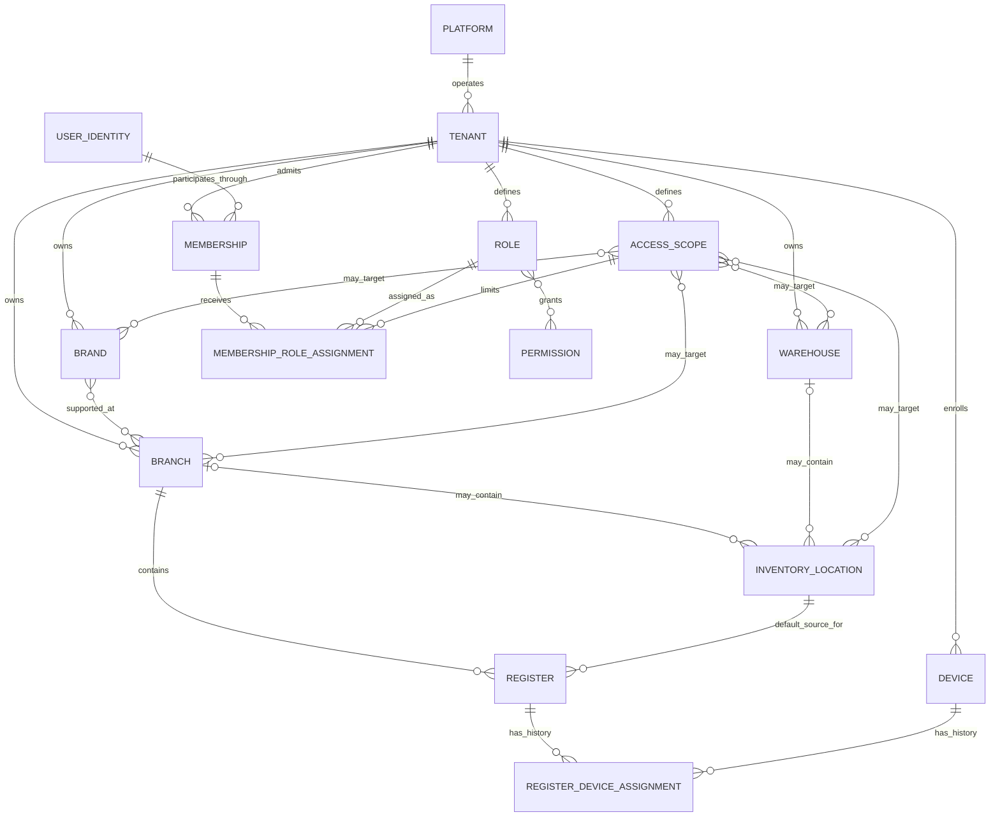

# Phase 1B Conceptual Domain Diagram

This diagram shows conceptual ownership and cardinality. It is not a database schema and does not
prescribe columns or SQL types.

The two parent relationships drawn to InventoryLocation express an exclusive-or invariant: each
location has exactly one parent, Branch or Warehouse, never both. The Register/Device assignment
relationships preserve sequential history; the recommended initial policy permits at most one
active assignment on either side.

Role-to-Permission and Branch-to-Brand are many-to-many conceptual relationships. Scope target
relationships represent explicit allowlisted roots. The entire-tenant scope has no individual
resource targets.

## Domain invariants beyond the diagram

- **CONFIRMED:** Future stock belongs to `Variant + InventoryLocation`, not SalesChannel.
- **CONFIRMED:** POS and ONLINE are origins in one future Order domain, not separate order models.
- **CONFIRMED:** Register is not Device; neither is an inventory owner.
- **CONFIRMED:** UserIdentity is global; Membership carries tenant participation.
- **CONFIRMED:** Permission is not Role, and AccessScope does not grant Permission.
